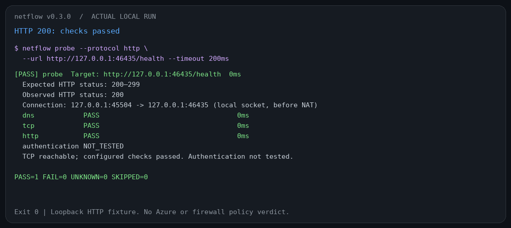

<div align="center">

# netflow

**Network reachability checks from Kubernetes Pods and VMs.**

[](https://github.com/uknowpro/netflow/actions/workflows/ci.yml)
[](https://github.com/uknowpro/netflow/releases)
[](LICENSE)

English · [한국어](docs/README.ko.md)

</div>

Test an IP or FQDN through **DNS → TCP → TLS → HTTP**. Get stage-level results, actual socket addresses, repeated-probe statistics, and JSON output. No controller or privileged networking required. Not a NetFlow/IPFIX collector.

## See it run



**Actual v0.3.0 runs against local HTTP fixtures**, not an Azure/AKS firewall test. The GIF renders captured CLI excerpts; only the source header is omitted. Ports and timings vary. [Plain-text transcript](docs/assets/demo.txt) · [Reproduce the demo](docs/DEMO.md)

<details>
<summary>Read the actual HTTP 403 result</summary>

```text
$ netflow probe --protocol http --url http://127.0.0.1:46435/denied --timeout 200ms
[FAIL] probe  Target: http://127.0.0.1:46435/denied  0ms
  Expected HTTP status: 200–299
  Observed HTTP status: 403
  Connection: 127.0.0.1:45512 -> 127.0.0.1:46435 (local socket, before NAT)
  dns            PASS                                  0ms
  tcp            PASS                                  0ms
  http           FAIL         HTTP_STATUS_MISMATCH     0ms
  authentication NOT_TESTED
  TCP reachable; a later check failed. Authentication not tested.

PASS=0 FAIL=1 UNKNOWN=0 SKIPPED=0
```

TCP connected successfully; the HTTP response did not match the default 200–299 expectation. This does not identify a WAF block or an authentication failure.

</details>

## Get started

Download your OS/CPU archive and verify its checksum from [v0.3.0 Releases](https://github.com/uknowpro/netflow/releases/tag/v0.3.0). Extract it and place `netflow` (`netflow.exe` on Windows) on your PATH. [Installation details](docs/SUPPORT.md)

```bash
# Database port: confirms TCP connectivity, not DB login.
netflow probe --host db.internal.example --port 5432 --protocol tcp

# HTTPS: use the real service FQDN for TLS and host-based routing.
netflow probe --protocol https --url https://api.example.com/health

# Repeat and export results.
netflow probe --host db.internal.example --port 5432 --count 20 --output json
```

Replace example domains with your authorized destinations. Container: `ghcr.io/uknowpro/netflow:v0.3.0` (Linux amd64/arm64). Build from source with Go 1.26+: `go build -o bin/netflow ./cmd/netflow`.

## Check flows from AKS or a VM

Start with an [AKS](examples/aks-flows.yaml), [Azure VM](examples/azure-vm-flows.yaml), or [on-premises VM](examples/onprem-vm-flows.yaml) configuration; replace the endpoints and expected paths.

```bash
# Execute inside the intended AKS source network.
netflow test --config examples/aks-flows.yaml --vantage aks --output json

# Execute on the intended Azure VM.
netflow test --config examples/azure-vm-flows.yaml --vantage azure-vm
```

**Run at the real source.** Outbound tests run in the source Pod/VM; inbound tests run outside the target system against its actual entry point. `vantage` is a label, not IP spoofing. Match the application's network conditions. [Kubernetes Job](examples/kubernetes-job.yaml) · [Deployment guide](docs/GUIDE.md#run-in-kubernetes)

Need a temporary TCP destination? Run `netflow serve --listen 0.0.0.0:8080 --duration 10m --output json` on the target and probe it from the source. It logs accepted peer addresses; it is not an HTTP/TLS service. [Receiver guide](docs/GUIDE.md#temporary-inbound-receiver)

## Read the result

| Result | Meaning |
| --- | --- |
| `PASS` | All configured checks passed |
| `FAIL` | An attempted stage failed; inspect its code |
| `SKIPPED` | Execution label mismatch; no probe sent |
| Exit `0` / `1` / `2` | Passed / failed or unverified / command or configuration error |

A timeout does **not** prove firewall blocking. TCP success does not verify authentication or every resolved IP. `expected_path` records operator-declared NSG/WAF/AppGW/firewall hops and remains **NOT_TESTED**. There is no Azure policy simulation or automatic blocking-device identification. Local addresses are before NAT.

## Documentation

- [Full guide](docs/GUIDE.md): YAML fields, retries, JSON, source identity, receiver, and troubleshooting limits.
- [Platform support](docs/SUPPORT.md): Linux, Windows, macOS, and experimental FreeBSD; 10 binary targets. Native CI covers Linux/Windows/macOS x64 and ARM64. Additional targets are cross-built only; real cloud paths remain unverified.
- [Development and release workflow](docs/GUIDE.md#development) · [MIT license](LICENSE)
