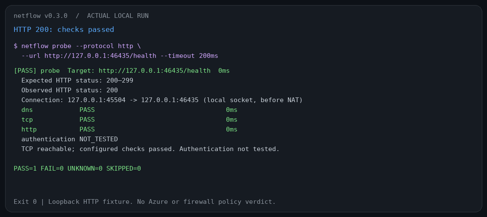

<div align="center">

# netflow

**Kubernetes Pod와 VM에서 실행하는 네트워크 연결 검사 CLI**

[](https://github.com/uknowpro/netflow/actions/workflows/ci.yml)
[](https://github.com/uknowpro/netflow/releases)
[](../LICENSE)

[English](../README.md) · 한국어

</div>

IP 또는 FQDN을 대상으로 **DNS → TCP → TLS → HTTP**를 검사합니다. 단계별 결과, 실제 소켓 주소, 반복 검사 통계, JSON 출력을 제공합니다. 중앙 컨트롤러나 네트워크 특권이 필요하지 않습니다. NetFlow/IPFIX 수집기와는 별개이며, CLI 출력은 영어입니다.

## 실제 실행 결과



**v0.3.0을 로컬 HTTP 테스트 서버에 실제 실행한 결과**입니다. Azure·AKS 방화벽 검증 결과는 아닙니다. GIF는 캡처한 CLI 결과를 렌더링했으며 출발지 정보 헤더만 생략했습니다. 포트·소요 시간은 실행마다 달라집니다. [텍스트 기록](assets/demo.txt) · [데모 재현](DEMO.md)

<details>
<summary>실제 HTTP 403 결과 펼쳐 보기</summary>

```text
$ netflow probe --protocol http --url http://127.0.0.1:46435/denied --timeout 200ms
[FAIL] probe  Target: http://127.0.0.1:46435/denied  0ms
  Expected HTTP status: 200–299
  Observed HTTP status: 403
  Connection: 127.0.0.1:45512 -> 127.0.0.1:46435 (local socket, before NAT)
  dns            PASS                                  0ms
  tcp            PASS                                  0ms
  http           FAIL         HTTP_STATUS_MISMATCH     0ms
  authentication NOT_TESTED
  TCP reachable; a later check failed. Authentication not tested.

PASS=0 FAIL=1 UNKNOWN=0 SKIPPED=0
```

TCP 연결은 성공했지만 HTTP 응답이 기본 기대값 200–299에 맞지 않았습니다. 이것만으로 WAF 차단이나 인증 실패를 확정하지 않습니다.

</details>

## 빠른 시작

[v0.3.1 Releases](https://github.com/uknowpro/netflow/releases/tag/v0.3.1)에서 OS·CPU에 맞는 파일을 내려받고 체크섬을 검증하세요. 압축을 풀고 `netflow`(Windows는 `netflow.exe`)를 PATH에 추가합니다. [설치 방법](SUPPORT.ko.md)

```bash
# DB 포트: TCP 연결 확인이며 DB 로그인 검사는 아닙니다.
netflow probe --host db.internal.example --port 5432 --protocol tcp

# HTTPS: 실제 서비스 FQDN으로 검사합니다.
netflow probe --protocol https --url https://api.example.com/health

# 반복 검사와 JSON 출력
netflow probe --host db.internal.example --port 5432 --count 20 --output json
```

예시 도메인을 검사할 실제 목적지로 바꾸세요. 컨테이너는 `ghcr.io/uknowpro/netflow:v0.3.1`(Linux amd64/arm64)을 사용합니다. 소스 빌드: Go 1.26 이상에서 `go build -o bin/netflow ./cmd/netflow`.

## AKS·VM에서 여러 경로 검사

[AKS](../examples/aks-flows.yaml), [Azure VM](../examples/azure-vm-flows.yaml), [온프레미스 VM](../examples/onprem-vm-flows.yaml) 예제의 목적지와 예상 경로를 실제 구성으로 바꾸세요.

```bash
# 검사하려는 AKS 출발지 네트워크에서 실행
netflow test --config examples/aks-flows.yaml --vantage aks --output json

# 검사하려는 Azure VM에서 실행
netflow test --config examples/azure-vm-flows.yaml --vantage azure-vm
```

**실제 출발지에서 실행해야 합니다.** Outbound는 출발지 Pod·VM에서, Inbound는 대상 시스템 외부에서 실제 진입점을 향해 검사합니다. `vantage`는 위치 이름이며 출발지 IP를 변경하지 않습니다. 애플리케이션과 네트워크 조건을 맞추세요. [Kubernetes Job](../examples/kubernetes-job.yaml) · [상세 배포 가이드](GUIDE.ko.md)

임시 TCP 목적지가 필요하면 대상에서 `netflow serve --listen 0.0.0.0:8080 --duration 10m --output json`을 실행하고 출발지에서 접속하세요. 수신한 연결의 상대 주소를 기록하며 HTTP/TLS 서버는 아닙니다. [수신기 상세 설명](GUIDE.ko.md)

## 결과 해석

| 결과 | 의미 |
| --- | --- |
| `PASS` | 설정한 검사가 모두 성공 |
| `FAIL` | 시도한 단계 실패, 결과 코드 확인 필요 |
| `SKIPPED` | 실행 위치 이름 불일치, 트래픽 미발생 |
| 종료 코드 `0` / `1` / `2` | 성공 / 실패 또는 미검증 / 명령·설정 오류 |

타임아웃만으로 방화벽 차단을 확정하지 않습니다. TCP 성공은 인증이나 모든 DNS 응답 IP의 통신 성공을 보장하지 않습니다. `expected_path`의 NSG·WAF·AppGW·방화벽은 사용자 선언이며 **NOT_TESTED**로 남습니다. Azure 정책 시뮬레이션·차단 장비 자동 식별은 지원하지 않습니다. 로컬 주소는 NAT 이전 주소입니다.

## 문서

- [상세 사용 가이드](GUIDE.ko.md): YAML 설정, 재시도, JSON, 출발지 정보, 수신기, 진단 한계.
- [지원 플랫폼](SUPPORT.ko.md): Linux·Windows·macOS 및 실험적 FreeBSD, 10종 바이너리. Linux·Windows·macOS의 x64/ARM64는 네이티브 CI 검증, 나머지는 교차 빌드만 수행합니다. 실제 클라우드 경로는 미검증입니다.
- [개발·릴리스 절차](GUIDE.ko.md) · [MIT 라이선스](../LICENSE)
